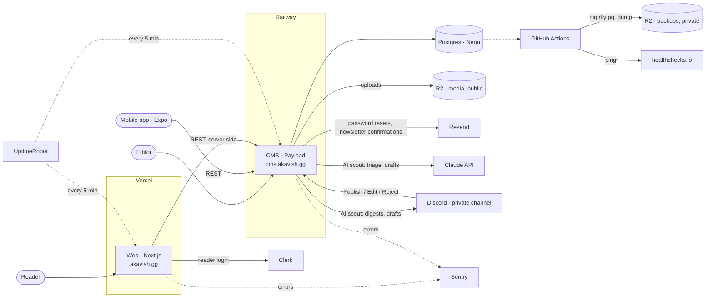

# Akavish (AKV)

> Breaking gaming news, exclusive leaks, in-depth reviews. Fast. Serious. No fluff.


## Stack

| Layer    | Tech                                                                |
| -------- | ------------------------------------------------------------------- |
| Web      | Next.js 15 (App Router) + TypeScript + Tailwind — runs on **:3000** |
| CMS      | Payload 3 (standalone Next.js app) — runs on **:3001**              |
| Mobile   | React Native + Expo + expo-router                                   |
| Database | PostgreSQL (Neon/Supabase)                                          |
| Auth     | Clerk (readers, web + mobile) · Payload auth (CMS editors)          |
| Search   | CMS/Postgres by default · Meilisearch when configured               |
| Storage  | Cloudflare R2                                                       |
| Email    | Resend (sending) · Cloudflare Email Routing (receiving)             |
| Monitoring | Vercel Web Analytics (traffic) · Sentry (errors + performance) · UptimeRobot (uptime) |
| Hosting  | Vercel (web) + Expo EAS (mobile)                                    |
| Monorepo | Turborepo + pnpm workspaces                                         |

## Structure

```
akavish/
├── apps/
│   ├── web/          # Next.js frontend (:3000) — pages + API routes that proxy the CMS
│   ├── cms/          # Standalone Payload CMS (:3001) — admin + REST/GraphQL API
│   └── mobile/       # Expo — iOS & Android
├── packages/
│   ├── types/        # Shared TypeScript types
│   ├── api-client/   # Shared API client (web & mobile consume same backend)
│   └── ui/           # Shared React components
├── infra/
│   └── backup-trigger/ # Cloudflare Worker that starts the nightly DB backup on time
├── scripts/          # Repo-level shell scripts (clean)
├── docker-compose.yml # Local Postgres + Meilisearch
├── turbo.json
├── pnpm-workspace.yaml # Workspaces, onlyBuiltDependencies, security overrides (single source — no nested copies)
└── tsconfig.base.json
```

Conventions: **one lockfile** (`pnpm-lock.yaml` at the root — npm/yarn and nested
lockfiles are gitignored), **one Prettier config** (root `.prettierrc`), and every
workspace exposes a `type-check` script so CI covers apps _and_ shared packages.

### How the pieces talk

The **CMS** (Payload, port 3001) owns the content and the database. It exposes a
REST API at `http://localhost:3001/api`. The **web** app (port 3000) is a thin
frontend: its server components fetch published articles from the CMS via
`CMS_URL` and render them. The **mobile** app hits the same CMS API. Newsletter
sign-ups go from the web's `/api/newsletter` to the CMS, which stores them and
sends the confirmation email through Resend (`apps/cms/README.md` →
Newsletter). The **AI scout** runs inside the CMS too: it reads games news
feeds, groups and scores stories with Claude, drafts the best ones, and asks
for a Publish / Edit / Reject click in a private Discord channel (`apps/cms/README.md` → AI scout). Reader auth
(login/signup) is handled by **Clerk** on the web; CMS editors log into Payload
admin separately.

In production, with the services around them:



Solid arrows are requests; dotted ones are monitoring and backups. Setup for
each service: [DEPLOYMENT.md](./DEPLOYMENT.md).

## Getting started

### Prerequisites

**Required**

- **Node 22 LTS (≥ 22.13)** — a `.nvmrc` pins 22, so `nvm use` is enough. The
  mobile app (Expo 58) requires ≥ 22.13; web and CMS also run on Node 20.
  Avoid Node 25+: Payload/Next can run out of heap memory on it.
  No nvm? Install Node 22 directly: `brew install node@22` (macOS) then
  `brew link --overwrite --force node@22`.
- **pnpm 10** — the exact version is pinned in `package.json#packageManager`, so
  `corepack enable` (ships with Node) installs the right one automatically.
  Otherwise: `npm i -g pnpm@10`. pnpm 9 is no longer supported — the repo relies
  on `onlyBuiltDependencies` in `pnpm-workspace.yaml`, which pnpm 9 ignores.
- **Docker** — `docker compose up -d` at the repo root starts the local
  **Postgres** (the CMS's dev database) and Meilisearch. The default
  `DATABASE_URL` in `apps/cms/.env.example` already points at it. Production runs
  on Neon, whose credentials never go in a local `.env`.

> `pnpm reset:db` needs no extra tooling — it uses the `pg` driver bundled with
> the CMS (no `psql` required).

**External accounts you'll need (free tiers are fine to start)**

- **Clerk** — for reader login/signup. Create an app at
  [clerk.com](https://clerk.com), grab the publishable + secret keys.
- **Meilisearch** — search. Integrated; run it locally with Docker (free,
  self-hosted). Only the managed _Meilisearch Cloud_ is paid.
- **Cloudflare R2** — media storage for uploads (required in production; the CMS
  host's disk is ephemeral). See [`DEPLOYMENT.md` §4b](./DEPLOYMENT.md). Leave
  `R2_BUCKET` unset locally to keep using local disk.
- **Resend** — transactional email from the CMS (password resets). Required in
  production, see [`DEPLOYMENT.md` §4c](./DEPLOYMENT.md). Leave `RESEND_API_KEY`
  unset locally and Payload just prints emails to the terminal.
- **Sentry** _(optional)_ — error and performance monitoring on both apps. Leave
  the DSN unset and it's a complete no-op; nothing to install to develop. Setup
  in [`DEPLOYMENT.md` §4d](./DEPLOYMENT.md).

**Recommended tooling**

- Git, and a code editor (VS Code config lives in `apps/cms/.vscode`).
- `brew` (macOS) for installing the above.

### Install

```bash
pnpm install
```

### Environment variables

Copy the example files and fill in your values:

```bash
cp apps/web/.env.example apps/web/.env
cp apps/cms/.env.example apps/cms/.env
cp apps/mobile/.env.example apps/mobile/.env
```

At minimum you need: `DATABASE_URL` + `PAYLOAD_SECRET` (CMS), and the Clerk keys

- `CMS_URL` (web). For correct SEO URLs in production, also set
  `NEXT_PUBLIC_SITE_URL` (e.g. `https://akavish.gg`) on the web app.

### Dev

The CMS and the web app are **separate processes on different ports**. Run them
in two terminals:

```bash
# Terminal 1 — CMS (Payload admin + API) on http://localhost:3001
cd apps/cms && pnpm devsafe

# Terminal 2 — web frontend on http://localhost:3000
cd apps/web && pnpm dev
```

- Public site: <http://localhost:3000>
- CMS admin: <http://localhost:3001/admin>

**Fresh database?** Fill it in one go (after `docker compose up -d` and
`cd apps/cms && pnpm migrate`):

```bash
pnpm seed
```

It creates an admin — **only if the database has no user yet** —
(`admin@akavish.test` / `akavish-local`, override with `SEED_ADMIN_EMAIL` /
`SEED_ADMIN_PASSWORD` in `apps/cms/.env`), plus a sample author, four fictional
games, tags and 8 published articles covering every category (one of them
`featured`, so it's the homepage lead), so the homepage shows its full layout. Re-running it only adds what's missing. It **refuses to run
unless `DATABASE_URL` points at localhost**. Cover images are generated and
uploaded only when media is stored on local disk; with `R2_BUCKET` set they're
skipped unless you pass `pnpm seed --with-images`.

> Articles only appear on the site once their **status is `Published`** in the
> CMS. Drafts are visible to logged-in editors only.

#### Search

The header search box and `/search` both hit `/api/search`, which has two
backends and uses whichever is available:

- **No setup (default)** — queries the CMS, i.e. Postgres `ILIKE` on title and
  excerpt (every word of the query must appear), newest first. Works out of the
  box, nothing to run.
- **Meilisearch** — used as soon as `MEILISEARCH_HOST` is set. Adds typo
  tolerance and relevance ranking.

So search is never broken: if Meilisearch is configured but down (or its index
was never built), the route falls back to the CMS instead of erroring.

To run Meilisearch locally (the keys are already stubbed in the `.env.example`
files):

```bash
# From the repo root — starts Meilisearch on http://localhost:7700
docker compose up -d

# Backfill the index with existing published articles (run once)
cd apps/cms && pnpm reindex:search
```

After that, publishing/editing an article in the CMS keeps the index in sync
**automatically** (Payload hooks) — no manual step in normal use.

`/api/search` reports which backend answered in its `engine` field
(`"cms"` or `"meilisearch"`), which is the quickest way to check your setup.

`pnpm reindex:search` is only a one-off catch-up: first setup, after a DB/index
wipe (`pnpm reset:db`), or to repair a desync if Meilisearch was down during a
publish. See `apps/cms/README.md` for details.

Mobile (optional):

```bash
cd apps/mobile && pnpm dev
```

Scan the QR code with the iPhone camera (or Expo Go on Android); the phone needs
**Expo Go for SDK 58**. On iPhone, Expo Go only opens a project when the phone and
the computer are signed in to the **same Expo account** (free): `npx expo login`
on the computer, then sign in inside Expo Go. Keep `EXPO_PUBLIC_CMS_URL` on the
production CMS or your Mac's LAN IP — `localhost` on a phone is the phone
(see `apps/mobile/.env.example`). Same Wi-Fi required, or `pnpm dev --tunnel`.
What the app does and how it's built: [`apps/mobile/README.md`](./apps/mobile/README.md).

### Resetting

Two independent tools:

```bash
# Build/deps clean — wipes node_modules, .next, .turbo, .expo, dist, *.tsbuildinfo.
# Leaves .env files and the database untouched.
pnpm clean
pnpm install          # then reinstall and you're back to a clean env

# Database reset — DESTRUCTIVE. Drops all data (articles, users, media…).
# No psql needed (uses the pg driver). Asks you to type "reset" to confirm.
pnpm reset:db                 # wipes the DEV db (DATABASE_URL from apps/cms/.env)
pnpm reset:db "<DATABASE_URL>"  # wipes a specific db, e.g. production
pnpm reset:db --yes           # skip the confirmation prompt
```

After a DB reset the schema is gone, so re-apply migrations to rebuild the tables:
`cd apps/cms && pnpm migrate` (add `DATABASE_URL='<url>'` inline to target prod).
Then open `/admin` to create a fresh first admin user — or, locally, run
`pnpm seed` to get an admin and sample content. See `DEPLOYMENT.md` §5.

> `reset:db` only touches the database. Run `pnpm clean` separately if you also
> want to wipe build artifacts.

## CI

GitHub Actions runs on every push to `main` and every pull request
(`.github/workflows/ci.yml`):

- **Lint, type-check & tests** — lint runs on web + CMS; type-check runs on web,
  CMS, and shared packages; `pnpm test` runs the vitest unit tests (web,
  mobile, CMS, `api-client`). Lint and type-check include mobile; mobile isn't built
  in CI (that needs EAS).
- **Database backup** (`.github/workflows/backup.yml`) — nightly `pg_dump` of
  production into a private R2 bucket. Setup and restore: `DEPLOYMENT.md` §9.
- **Build & CMS tests** — `pnpm build` (web + CMS) against a throwaway Postgres
  service with dummy env values (Meilisearch, R2, Resend, Sentry unset; each
  degrades gracefully). Then, on that database: every migration applied from
  scratch, `pnpm seed`, the CMS integration tests (`test:int`), then Playwright
  on the production builds: the admin panel (`apps/cms`, `test:e2e`) and the
  public site (`apps/web`, `test:e2e`: home, categories, articles, real 404s,
  search, slug-rename 308, sitemap/RSS, theme toggle).

Run the same checks locally before pushing:

```bash
pnpm lint && pnpm type-check && pnpm test && pnpm build
```

Both apps lint via ESLint flat config (`eslint.config.mjs`) using
`eslint-config-next`'s native flat presets — no `next lint`, no FlatCompat.

> The build job uses `pnpm install --frozen-lockfile`, so commit an up-to-date
> `pnpm-lock.yaml` whenever you change dependencies.

### Dependency updates

Dependabot (`.github/dependabot.yml`) opens update PRs every Monday morning,
grouped: one PR for all minor/patch bumps, one for Payload (its packages must
share a version), one for Sentry, and one PR per major version. GitHub Actions
versions are checked monthly. Security fixes arrive on their own, right away.

Each PR runs the full CI. **Green → merge** (squash). **Red → don't merge**:
open the failing step, fix on the PR branch or close it. Majors deserve a look
at the package's changelog even when green.

React, React Native and Expo are **ignored on purpose**: Expo pins an exact React
that must match React Native, so they move together through an Expo SDK upgrade
(`npx expo install --fix`), not one bump at a time.

A Dependabot run that fails with `ERR_PNPM_NO_MATURE_MATCHING_VERSION` isn't
our bug: Dependabot only takes versions at least 3 days old, and a package in
the lockfile is younger than that (Expo 58.0.23 once, two days after its
release). A one-off clears itself on a later run. If it's a package that
publishes every week (it was `caniuse-lite` on 2026-11-09, which blocked every
npm update that run), it would keep coming back: list it under
`minimumReleaseAgeExclude` in `pnpm-workspace.yaml`, only for data-only
packages like that one.

**Security alerts** (GitHub → Security → Dependabot) are separate from the weekly
PRs. A direct dependency gets fixed by bumping it; a vulnerable *transitive*
one by a pinned entry under `overrides:` in `pnpm-workspace.yaml`, always kept
inside its parent's major (`'pkg@>=7.0.0 <7.30.1': '^7.30.1'`, never a bare
`>=`). Check what's left with `pnpm audit`. First cleanup (2026-11-06): 298
alerts → 5 low/moderate ones in build-only tooling with no fix in the same
major (esbuild, glob, minimatch, deepmerge).

## Deployment

Going to production? Follow **[DEPLOYMENT.md](./DEPLOYMENT.md)** — a step-by-step
runbook (web → Vercel, CMS → Railway/Render, Postgres → Neon, migrations,
search, domains, and a post-deploy checklist).

## Project status & roadmap

There is **one** source of truth for what's built, in progress, and still to do:

### 👉 [PROGRESS.md](./PROGRESS.md)

It lists everything done (grouped by area) and the full prioritized backlog
(pages, back-office, deployment, legal, mobile…). Keep it updated as work lands —
this README only covers _what the project is and how to run it_, not status.

## Contributing / working agreement

How to add a CMS field, a page or a test without breaking production:
**[CONTRIBUTING.md](./CONTRIBUTING.md)**.

[`CLAUDE.md`](./CLAUDE.md) and [`AGENTS.md`](./AGENTS.md) at the repo root hold
the standing conventions for AI-assisted changes: keep all docs/config in sync,
distinguish a DB-migration push from a normal push, and finish with an exact
commit command. The two files are **mirrors** (one per assistant) — edit one,
edit the other.
